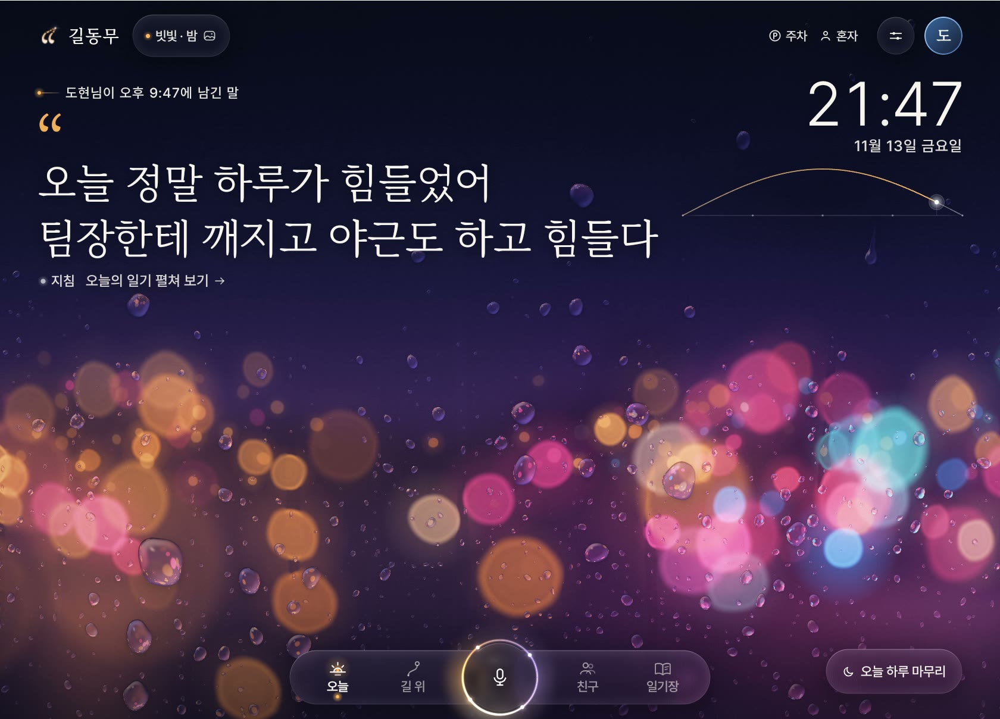
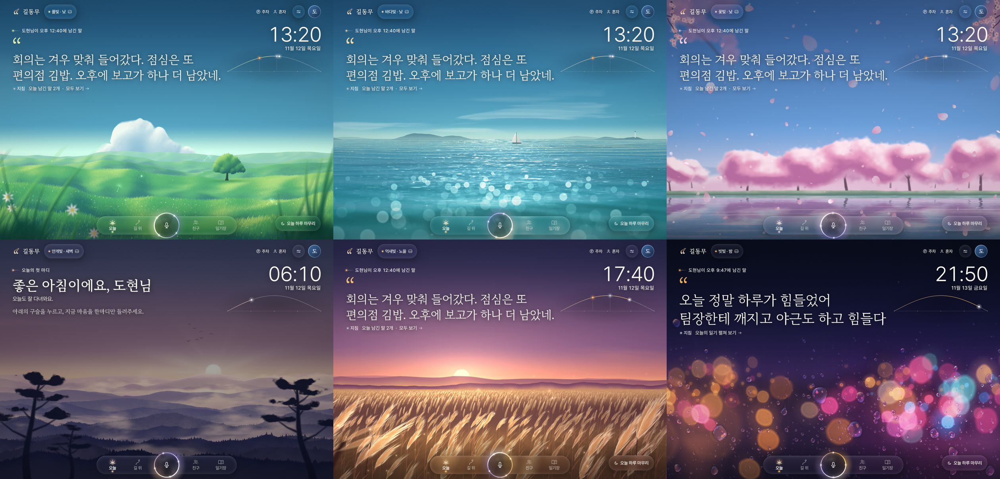
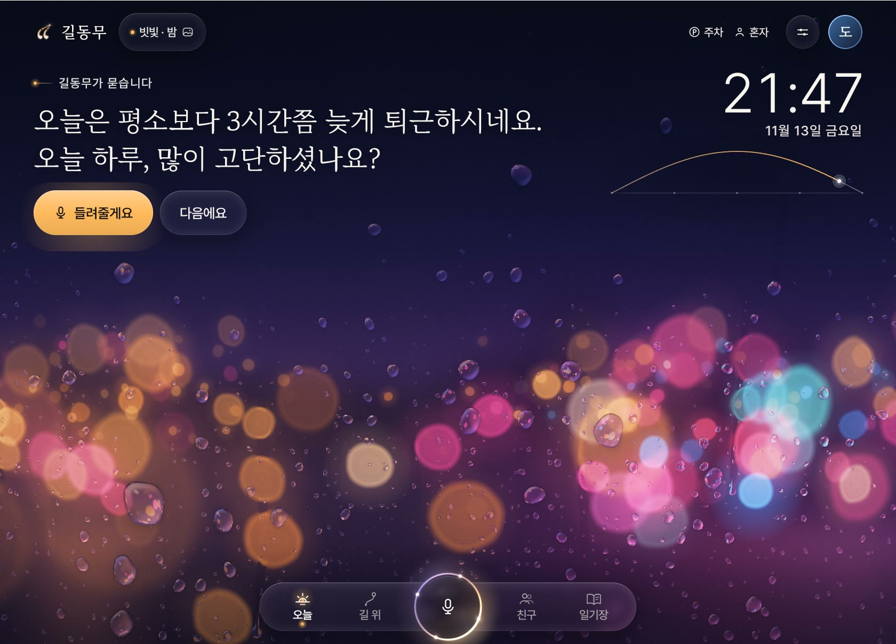
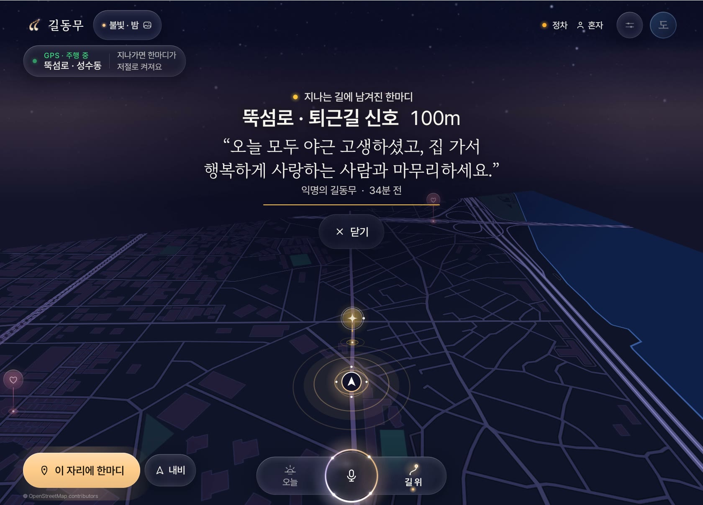
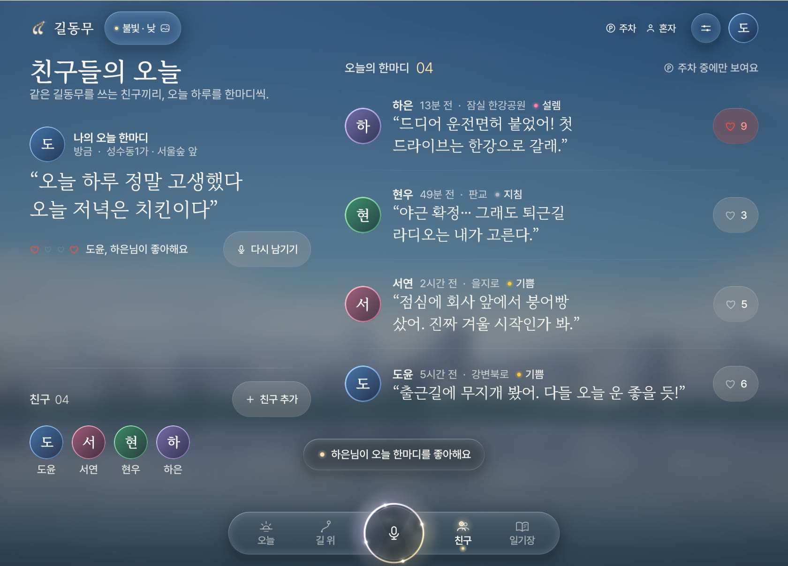
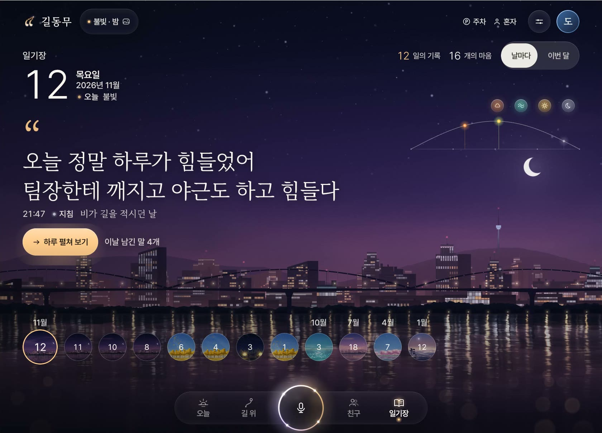
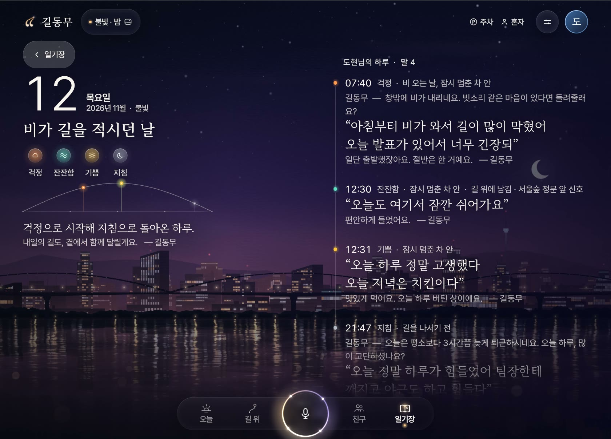
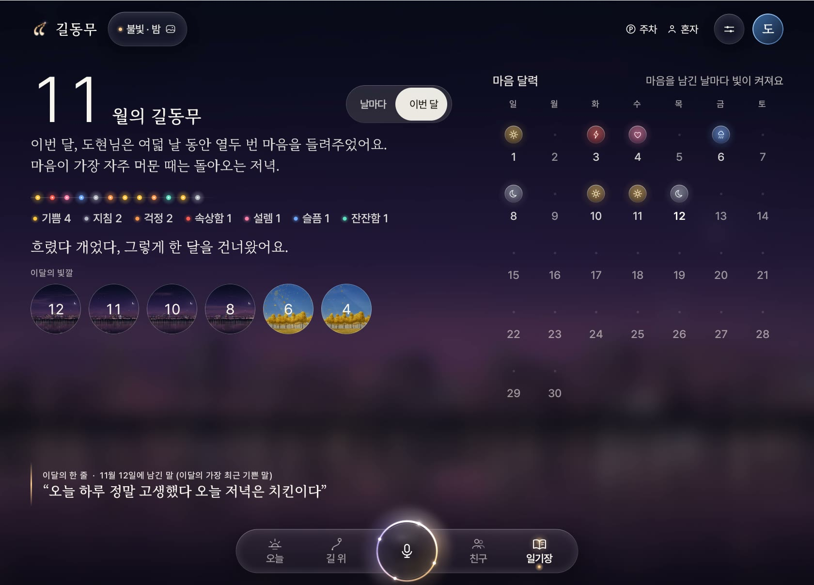
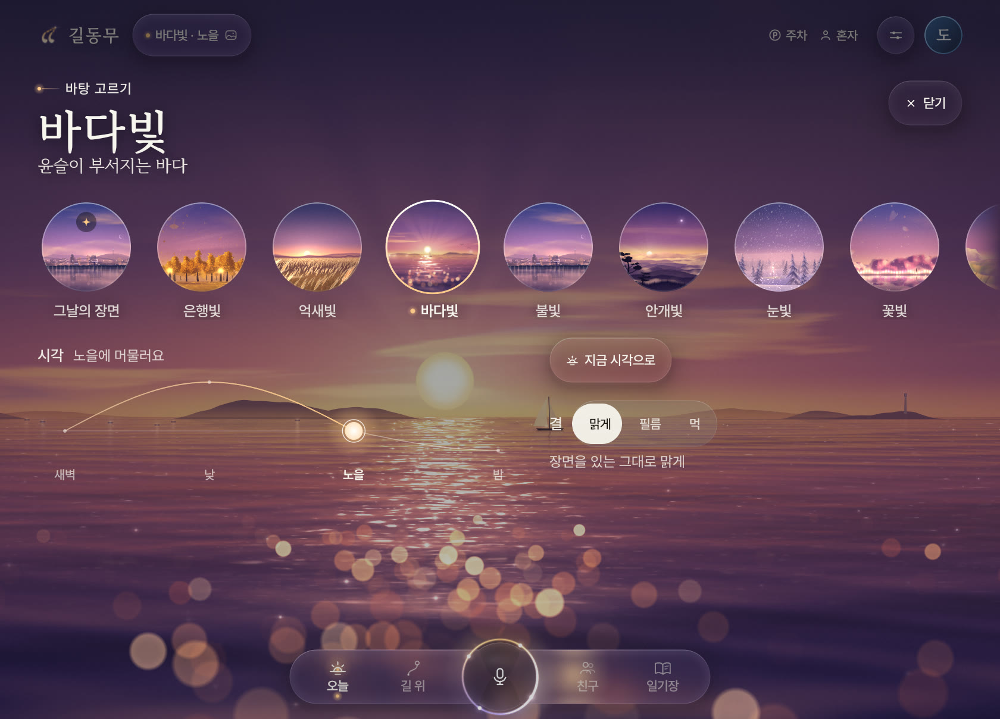

# 길동무 — 운전길에 말로 쓰는 일기


혼자 운전하는 시간에 건넨 말 한마디가, 그날의 장면과 함께 한 줄 글귀로 남는 차량용 앱입니다.
현대자동차그룹 차량용 앱 개발 공모전 출품작이며, Pleos Connect(AAOS) 에뮬레이터에서 동작합니다.

로고 「따옴길」: 첫 화면의 여는 따옴표(“)에서 꼬리가 차선이 되어 지평선 끝 작은 불빛까지 이어집니다. 달리며 건넨 한마디가 길이 되어, 같은 길을 지나는 누군가에게 닿는다는 뜻입니다.
따옴표는 앱의 명조 글꼴(마루 부리)의 “ 모양 그대로이고, 아이콘은 벡터(adaptive icon)로 그렸습니다.

**소개 웹사이트**: <https://gildongmu-app.github.io/gildongmu/> — 만든 이유, 실제 화면, 시연 영상(3분 52초)과 처음 실행부터 끊지 않고 찍은 실제 에뮬레이터 시연(2분 15초), 그리고 앱에 든 것과 같은 AI 모델을 브라우저에서 직접 돌려 보는 ‘해 보기’가 있습니다. 소스는 [`docs/`](docs/) 폴더입니다.



길동무의 얼굴은 **빗빛 · 밤**(비 오는 밤, 창에 맺힌 빗방울과 번진 불빛)입니다. 앱을 처음 켜면 이 장면이 깔리고, 바탕 고르기에서 다른 장면이나 ‘그날의 장면’(계절·시각·날씨를 따라 바뀜)으로 바꿀 수 있습니다.



| 처음 켰을 때 — 밤길을 달리는 차와 한마디들 | 먼저 묻는 길동무 | 말하는 중 |
|---|---|---|
|  |  |  |

| AI가 읽은 마음결과 길동무의 답 | 오늘 — 내가 남긴 말이 주인공 | 길 위 — 신호에 선 동안의 한마디 |
|---|---|---|
|  |  |  |

| AI 필터 — 길 위에 올리지 않은 말 | 목소리 확인 | 친구들의 오늘 |
|---|---|---|
|  |  |  |

| 일기장 | 하루 펼쳐 보기 | 이번 달 |
|---|---|---|
|  |  |  |

| 바탕 고르기 — 해를 끌면 하늘빛이 바뀐다 |
|---|
|  |

화면 속 이름(도현·서윤)과 글은 지어낸 것이고, 전화번호는 지어낸 번호의 일부를 가렸습니다.

## 무엇을 하는 앱인가

- **말로 쓰는 일기** — 말하기 구슬을 누르고 말하면, 내 말이 화면에 자막처럼 떠오르고 말을 멈출 때 스스로 담습니다. 글에서 일곱 가지 감정을 읽어 그날의 '마음의 날씨'로 남깁니다.
- **길동무가 먼저 묻는다** — 평소보다 이른/늦은 출발, 먼 길 끝의 도착, 비 오는 날, 늦은 밤, 저녁 귀가처럼 '물어봐도 좋은 순간'에, **혼자 탔을 때만** 먼저 안부를 묻습니다.
- **목소리로 일기 주인 확인** — 운전자마다 계정이 따로 있고, 다른 목소리가 들리면 누구의 일기에 담을지 먼저 묻습니다. 녹음은 저장하지 않고 목소리 특징값(숫자)만 차 안에 둡니다.
- **한 줄 글귀가 되는 일기장** — 그날 남긴 말이 큰 글귀 한 줄로 남고, 바탕에는 그 말을 남긴 순간의 장면과 빛이 함께 남습니다. 하루를 덮으면 화면이 밤으로 저뭅니다. 한 달은 마음 달력으로 돌아봅니다.
- **길 위의 한마디** — 내비가 아닙니다. 다른 길동무가 그 자리에 남긴 한마디·공유 일기·주의 알림이 지나갈 때 저절로 켜지고 목소리로 읽힙니다.
- **친구들의 오늘** — 같은 앱을 쓰는 친구끼리 오늘의 한마디와 공감을 나눕니다. 주차 중에만 열립니다.
- **살아 있는 바탕** — 화면 뒤에는 그림 파일이 아니라 그 자리에서 그려지는 장면이 깔립니다. 열 가지 — 불빛(강 건너 도시), 안개빛(새벽 능선), 바다빛(윤슬), 풀빛(바람 부는 언덕), 억새빛, 꽃빛(벚꽃), 은행빛, 눈빛, 빗빛(비 오는 창), 빛결 — 이 계절·시각·날씨(와이퍼)·날짜에 따라 번갈아 깔리고, 마음에 드는 장면을 직접 고를 수도 있습니다. 장면마다 새벽·낮·노을·밤의 빛이 따로 있고, 바람이 불고, 달리는 동안에는 차창 밖처럼 흘러갑니다. 운전자마다 그 위에 입히는 결(**맑게 · 필름 · 먹**)을 고릅니다.
- **주행과 정차를 다르게** — 달리는 동안에는 글을 치우고, 초점을 풀어 잔잔해진 장면과 말하기 구슬만 남깁니다. 일기장·친구·설정은 차를 세워야 열리고, 지나는 길의 이야기는 한 줄로만 뜨고 내용은 목소리로 읽어 줍니다.

## 화면 디자인 — "살아 있는 바탕, 유리, 글"

- 화면의 주인공은 운전하는 사람의 말입니다. 첫 화면에는 시계가 아니라 오늘 남긴 말이 큰 명조 글귀로 서고(시계와 하루의 호는 오른쪽 위에 작게), 줄마다 가림막 뒤에서 올라오며 나타납니다. 길동무의 물음도 카드 없이 같은 자리에 섭니다.
- **누구의 말인지 늘 밝힙니다.** 첫 화면의 글귀는 언제나 '이 운전자가 오늘 가장 마지막에 남긴 말'이고, 글귀 위에 "도현님이 오후 5:43에 남긴 말"처럼 누가·언제 남겼는지 적힙니다(새로 말하면 그 말로 바뀌고, 저절로 바뀌지 않습니다. 오늘 남긴 말이 없으면 인사가 대신 섭니다). 길동무가 붙이는 한 줄에는 "— 길동무"가, 다른 사람의 말에는 그 사람의 이름이 붙습니다.
- 바탕은 살아 있는 장면입니다. 글은 잔잔한 위쪽에, 볼거리는 아래쪽에 둡니다. 글이 많은 화면에서는 장면 전체가 초점 밖으로 흐려집니다.
- 네모난 판(카드·패널·막대)은 쓰지 않습니다. 글은 가장자리 없이 스르르 사라지는 어스름 위에 직접 놓고, 조작만 **유리**로 된 알약·동그라미에 올립니다. 유리 뒤로는 장면(또는 지도)이 실제로 흐려지고 가장자리에서 굴절됩니다.
- **길 위**에서는 이야기 목록을 펼치지 않습니다. 고른 이야기 하나만 크게 놓이고, 나머지는 오른쪽 가장자리의 눈금 줄(아래가 가깝고 위가 멂)을 누르거나 쓸어서 넘기면 지도가 그 자리로 따라갑니다. 이어 남긴 한마디는 글을 눌러 한 번에 하나씩 넘겨 봅니다.
- **바탕 고르기**에서는 장면이 구슬로 늘어서고, 하루의 길 위에 놓인 해를 끌면 끄는 동안 화면의 하늘빛이 그 시각의 빛으로 바로 바뀝니다.
- 말하기는 테두리를 따라 빛이 도는 **구슬** 하나에 모았습니다. 길동무가 듣는 동안 구슬이 목소리를 따라 일렁이고 고리가 퍼져 나갑니다.
- 하루는 자정에서 자정까지를 잇는 **호** 한 줄로 그립니다. 마음을 남긴 시각마다 그 감정의 빛이 맺히고, 지금 시각은 호 위를 움직이는 점입니다.
- 아이콘은 모두 가는 선과 점으로 직접 그렸고, 앱의 중심 색은 지금 깔린 장면과 시각에서 옵니다. 한글은 낱말 단위로 줄이 바뀝니다.
- 아래 가운데의 길잡이(오늘 · 길 위 · 말하기 · 친구 · 일기장)는 떠 있는 유리 알약 하나입니다.

## 실행 방법

### 1) 준비물

- JDK 17, Android SDK (compileSdk 35)
- Pleos Connect 에뮬레이터 — 설치는 [Pleos 개발 문서](https://document.pleos.ai)의 에뮬레이터 안내를 따릅니다.
- 마이크로 말하려면 에뮬레이터를 호스트 마이크와 함께 실행합니다: `emulator -avd <AVD 이름> -allow-host-audio`
  - macOS에서 에뮬레이터에 마이크 권한이 없으면 시작 중에 멈출 수 있습니다. 그럴 때는 `-no-audio` 를 붙여 실행하고, 설정의 시연 음성으로 확인합니다.

### 2) APK로 바로 설치

```bash
adb install -r -g apk/한끗_길동무_release.apk
```

`-g` 는 마이크·위치·알림 권한을 미리 허용합니다. 설치 뒤 앱 목록에서 **길동무**를 엽니다.

### 3) 소스에서 빌드

```bash
./gradlew assembleDebug
adb install -r -g app/build/outputs/apk/debug/app-debug.apk
```

Pleos Connect SDK는 `settings.gradle.kts` 에 적힌 Pleos Playground 저장소에서 받아 옵니다.

### 4) 처음 써 보기

1. 처음 켜면 **런치 화면**이 섭니다. 밤길 위로 차 한 대가 달리고, 하늘에 누군가 차 안에서 했을 법한 한마디 네 줄이 빠르게 적힙니다. 말이 끝나면 길의 두 선이 휘어 올라 따옴표 둘이 되어 "오늘 하루는 어떠셨나요?" 하고 묻고, 두 따옴표가 모여 로고 「따옴길」이 됩니다(누르면 건너뜀). **시작하기**를 누르고 이름과 결을 고릅니다. (목소리 등록은 선택. 달리는 중에는 시작할 수 없습니다. 설정 › 시연 도구 › `시작 화면부터 보기`로 다시 볼 수 있습니다)
   - 차의 운전자 이름은 지금 Pleos가 일반 앱에 열어 두지 않아서(운전자 프로필 API는 승인된 privileged 앱 전용), 이름은 처음 시작할 때 직접 정합니다.
   - 다음부터는 차에 타서 앱을 켜거나 운전자를 고르면, "어서 오세요, ○○님." 하고 인사하는 환영 화면이 잠깐 나옵니다(5초 남짓, 누르면 건너뜀).
2. **오늘** 화면 아래 가운데의 **말하기 구슬**을 누르고 한마디 합니다.
3. **설정(오른쪽 위) → 시연 도구 → 펼치기**에서 아래를 눌러 볼 수 있습니다.
   - `지난 2주 예시 일기` — 일기장·이번 달 화면을 채웁니다.
   - `평일 8시 반 출근 기록` 뒤 `이른 출발 6:50` — "평소보다 일찍 나섰네요" 하고 먼저 묻는 장면.
   - `혼자 탄 상황`, `비 오는 날`, `늦은 밤 23:40`, `먼 길 끝 2시간 30분`.
4. 왼쪽 위의 장면 이름(예: "불빛 · 노을")을 누르면 **바탕 고르기**가 열립니다. 장면 구슬을 누르고, 해를 끌어 시각을 바꾸고, 결을 골라 봅니다. ('그날의 장면'과 '지금 시각'으로 두면 날짜와 시각을 따릅니다.)
5. 차량 상태(기어 P/D, 좌석, 와이퍼)는 에뮬레이터의 차량 제어 패널에서 바꿉니다.

## 테스트 환경

| 항목 | 값 |
|---|---|
| Pleos Connect 에뮬레이터 | 시스템 이미지 `pleos_car_emulator` (android-34, arm64-v8a), 빌드 `release_connect_v2.1.0` · Android Emulator 36.5.11 |
| 화면 규격 | 2560×1440, 160dpi (가로). 앱 창은 그 안의 1680×1208 영역 |
| 기기 | Car on arm64 emulator, Android 14 (API 34) |
| 빌드 | Gradle 8.14.3, Android Gradle Plugin 8.8.2, Kotlin 2.0.0, JDK 17 |
| 앱 | minSdk 28, targetSdk 34, Jetpack Compose |
| Pleos Connect SDK | Vehicle 2.3.2, NaviHelper 3.0.5, SpeechToText 3.3.1, TextToSpeech 3.3.1 |
| 필요한 권한 | 마이크, 위치, 알림 (+ Pleos 차량·음성·내비 권한은 매니페스트에 선언) |

## 디버그 빌드에서 장면 재현하기

디버그 빌드는 adb 명령으로 시연 상황을 만들 수 있습니다 (release 빌드에서는 꺼져 있습니다).

```bash
gd() { adb shell am start -n com.gildongmu.app/.MainActivity -a GD_DEMO "$@"; }
gd --es cmd seed --ez entries true                 # 출근 기록과 예시 일기
gd --es cmd alone --ez on true                     # 혼자 탄 상황
gd --es cmd think --es phase depart --ei hour 6 --ei minute 50   # 이른 출발 → 먼저 묻기
gd --es cmd drive --es act start                   # 뚝섬로를 따라 시연 주행 (지나가는 한마디가 켜짐)
gd --es cmd art --es name GRAIN                    # 결: AURA(맑게) GRAIN(필름) INK(먹)
gd --es cmd look --es scene COAST --es part DUSK   # 장면: CITY RIDGES COAST GREEN REEDS BLOSSOM GINKGO SNOW RAIN AURORA / 시각: DAWN DAY DUSK NIGHT
gd --es cmd picker --ez on true                    # 바탕 고르기 열기
gd --es cmd look --es season auto --es part auto --es scene auto   # 날짜와 시각을 따르게 되돌림
gd --es cmd rain --ez on true                      # 비 오는 날
gd --es cmd endday                                 # 오늘 하루 마무리
gd --es cmd launch --ez on true                    # 런치 화면 보기 (계정이 있어도) / --ez on false 로 되돌림
gd --es cmd board --ei hour 21 --ei minute 47      # 차에 탄 순간: 환영 인사 → 길동무의 물음
gd --es cmd share --es mode road                   # 말한 것을 길 위에도 남기기 (diary 로 되돌림)
gd --es cmd ai --es text '오늘 정말 하루가 힘들었어'   # AI 마음결·AI 필터 판단을 로그로
```

## 소스 구조

`app/src/main/java/com/gildongmu/app/`

| 파일 | 하는 일 |
|---|---|
| `MainActivity.kt` | 권한, 글레오 진입(START_DIARY), 디버그용 시연 명령 |
| `AppModel.kt` | 앱 상태와 흐름 (듣기·저장, 먼저 묻기, 하루 마무리, 위치와 지나가며 보기, 친구) |
| `Car.kt` | 차량 신호(기어·좌석·와이퍼) 읽기와 '지금 물어볼까'를 정하는 규칙 |
| `Voice.kt` | 음성 인식·읽어 주기, 목소리 특징값 |
| `Diary.kt` | 감정 읽기와 일기 문장 |
| `Store.kt` | 기기 안 저장소 (운전자별 일기·설정) |
| `Navi.kt`, `Notify.kt` | 내비 연동, 지나는 길 알림 |
| `Places.kt`, `MapData.kt`, `Road.kt` | 길 위의 한마디: 예시 데이터, 자체 지도(실제 OSM 데이터), 지도 화면 |
| `Ui.kt`, `Picker.kt` | 뼈대(위 줄·아래 길잡이), 오늘 화면, 말하기·저장·마무리 화면, 바탕 고르기 |
| `Journal.kt`, `FriendsUi.kt`, `People.kt` | 일기장·이번 달, 친구, 첫 화면·설정 |
| `Scenery.kt`, `Scene.kt` | 그날의 장면 고르기(계절·시각·날씨·날짜), 살아 있는 바탕 그리기 (장면마다 AGSL 셰이더 한 편: `assets/scenes/*.agsl`) |
| `Glass.kt`, `Motion.kt` | 뒤가 흐려지고 굴절되는 유리, 움직이는 글·숫자·하루의 호 |
| `LightField.kt` | 셰이더를 쓸 수 없는 기기에서 대신 깔리는 번지는 빛 |
| `Soft.kt` | 옅은 유리(frost)·어스름(mist)·말하기 구슬(Orb, AGSL 셰이더) |
| `Skin.kt`, `Theme.kt`, `Fx.kt` | 결, 색과 글꼴, 공용 부품(알약 버튼·고르기·스위치) |
| `Lights.kt`, `Draw.kt`, `Art.kt` | 가는 숫자·감정 구슬·사람 표시, 감정과 표지 그림, 선 아이콘 |
| `Ai.kt` | 기기 안의 AI: 마음결·해치는 말 모델(글자 1~3개 묶음 + 로지스틱 회귀)과, 거친 말을 담지 않고 개인 정보를 거르는 AI 필터 |
| `Launch.kt`, `Welcome.kt`, `LogoPaths.kt` | 처음 화면(밤길을 달리는 차와 한마디 → 따옴표 → 로고), 차에 탔을 때의 환영 인사, 로고 도형 |

그 밖의 폴더: `tools/ai/`(모델 학습 스크립트와 예시 문장), `docs/`(소개 웹사이트 — GitHub Pages 로 보입니다), `tools/site/`(웹사이트용 글꼴 만들기·셰이더 변환·AI 이식 확인), `apk/`(release APK).

## 길게 말해도 됩니다

한마디만 받는 것이 아닙니다. 길게 이어 말해도 끊지 않고 끝까지 받아 적어 일기에 통째로 담습니다(2분이 넘으면 거기까지 담습니다).
다만 큰 글귀 자리와 길 위에는, 기기 안의 AI가 그 말에서 **마음이 가장 실린 한 문장**을 골라 올립니다(`Words.headline`). 전체는 일기장의 ‘하루 펼쳐 보기’에서 읽습니다.

## 길동무의 목소리

처음 계정을 만들 때 성별을 고를 수 있습니다(고르지 않아도 됩니다). 길동무는 운전자와 다른 성별의 목소리로 말을 건네고, 설정 › 말 걸기 › ‘길동무의 목소리’에서 언제든 바꿀 수 있습니다.
목소리는 Pleos TextToSpeech 의 한국어 화자 네 가지입니다(여성 하은·서윤, 남성 은우·상혁, `setSpeakerType`).
음성 인식이 소리 나는 대로 적은 흔한 맞춤법 잘못은 바로잡아 담습니다(‘긴장되’ → ‘긴장돼’, ‘되요’ → ‘돼요’ 등, `Words.tidy`).

## 거친 말은 담지 않습니다

욕설이나 누군가를 깎아내리고 위협하는 말이 섞이면, 길동무는 그 말을 담지 않습니다. "거친 말은 담을 수 없어요" 하고 알린 뒤 곧바로 한 번 더 듣습니다(다시 들은 말도 거칠면 알리기만 하고, 다시 말할지는 맡깁니다).
전화번호 같은 개인 정보와 광고는 묻지 않고 알아서 걸러, 길 위에는 올리지 않고 내 일기에만 담습니다. 마음이 많이 힘든 말은 막지도 나무라지도 않고 따로 답합니다. 판단은 모두 기기 안에서 합니다(`Ai.kt` 의 `Guard`).

- 사전은 멀쩡한 말을 잘못 막지 않도록 낱말 단위로 봅니다('한강 간다', '의자 위에', '다시 바꿔', '두 개 같이' 같은 말). `node tools/site/test_ai.mjs` 가 거친 말 25문장과 멀쩡한 말 40문장으로 확인하고, 앱과 웹사이트의 사전이 글자 하나까지 같은지도 봅니다.
- AI 모델은 예시 문장 594개로 학습했습니다: 5겹 교차 검증 81%, 학습에 쓰지 않은 75문장 가운데 70개를 맞혔고, 따로 둔 '해치는 말' 13문장 가운데 11개를 막았습니다(괜찮은 말 95문장은 하나도 잘못 막지 않음). 확신이 낮은 문장은 '잔잔함'으로 둡니다. 틀린 것까지 `tools/ai/report.txt` 에 적혀 있습니다.

## 만든 이와 사용 조건

Made by 한끗 Team · © 2026 한끗. 이 저장소는 공모전 심사를 위해 공개한 것이며, 그 밖의 이용에는 허락이 필요합니다([LICENSE](LICENSE)).
앱(설정 › 만든 이)과 웹사이트 맨 아래에는 만든 사람의 서명이 비밀번호로 봉인되어 들어 있습니다. 비밀번호 없이는 읽을 수도, 바꿔 넣을 수도 없습니다(`tools/maker/seal.py`).

## 아직 시연용인 부분

- 다른 운전자와 친구의 글·공감은 기기 안의 **예시 데이터**입니다. 서버는 아직 없습니다.
- 주행은 에뮬레이터에서 **재현**한 것입니다. 실제 주행 중 화면 표시는 주행 중 사용 승인 절차가 필요합니다.
- 일기 문장과 감정 읽기는 기기 안의 규칙과 문장 틀로 만듭니다 (언어 모델 연결 전).
- 위치는 표준 위치 API를 씁니다 (FusedLocation SDK로 교체 예정).
- 지도는 성수동·서울숲 일대만 담겨 있습니다.

## 쓴 것과 사용 조건

자세한 내용은 [NOTICE.md](NOTICE.md) 에 있습니다.

- 글꼴: Pretendard, 마루 부리(MaruBuri) — SIL Open Font License 1.1
- 지도 데이터: © OpenStreetMap contributors (ODbL)
- Pleos Connect SDK: Pleos Playground 제공
- 앱 안에는 그림·사진 파일이 없습니다. 바탕의 빛과 아이콘은 모두 앱이 직접 그립니다.
